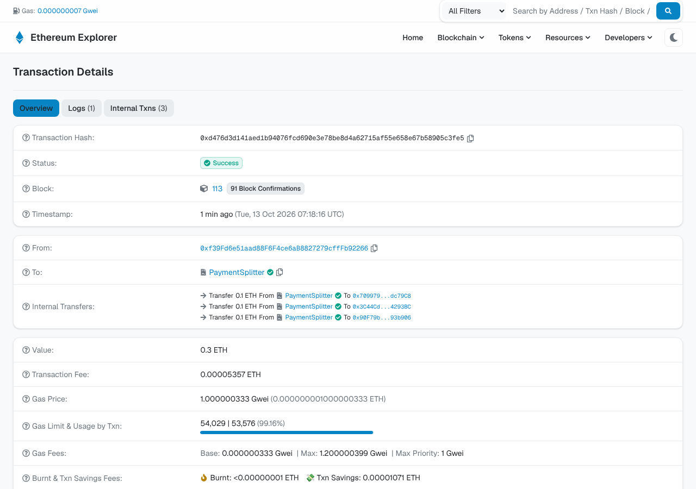
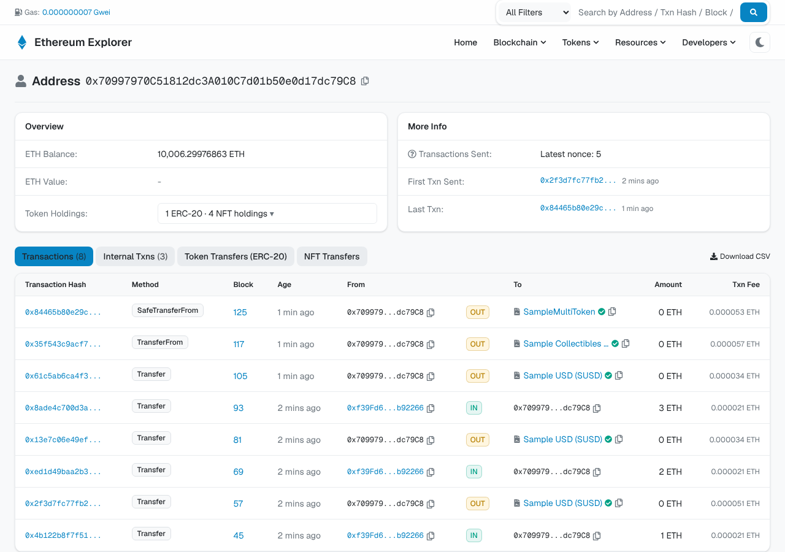
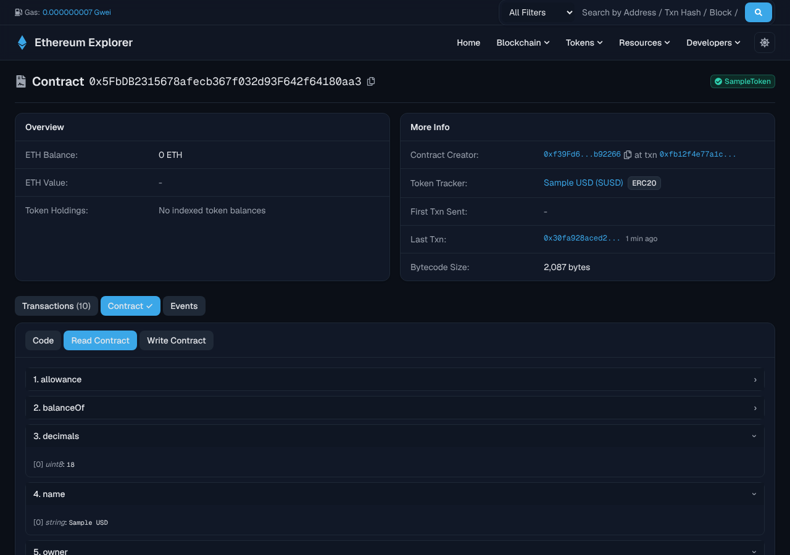
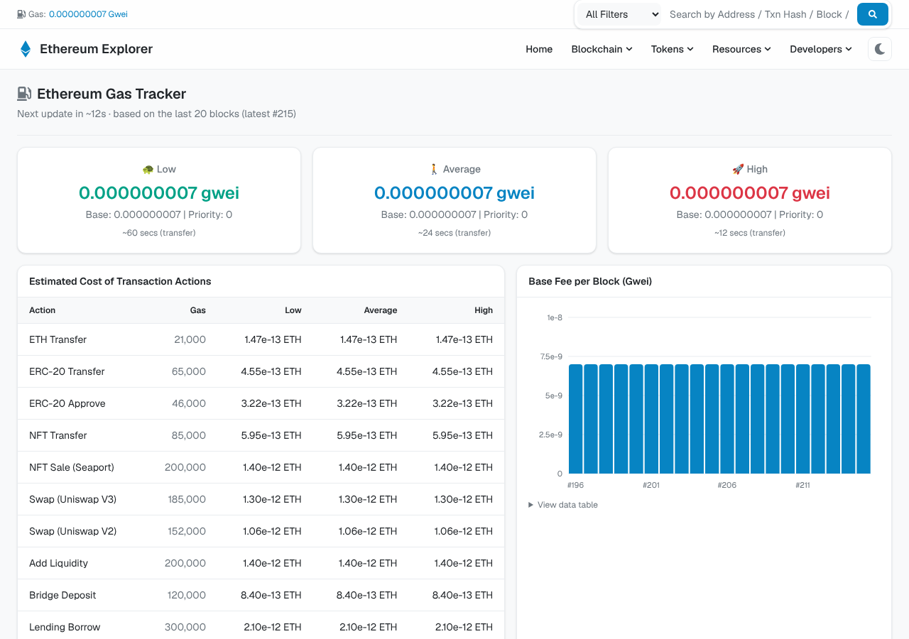

# EVM Block Explorer: Next.js + MongoDB

A self-hostable, production-grade block explorer for Ethereum and any EVM chain: a resilient indexer, an Etherscan-style UI, a REST API, an **Etherscan-compatible API** (works with Hardhat/Foundry verification), **smart contract source verification**, a **gas tracker**, token and NFT tracking, internal transactions, charts and developer tools.

🌐 **Live Demo**: [https://nextjs-ethereum-explorer.vercel.app/](https://nextjs-ethereum-explorer.vercel.app/)

> **Note**: The live demo has sync disabled to manage database costs. For full functionality, run the explorer locally or deploy with your own database.

<div align="center">
  
</div>

---

## ✨ Features

**Explorer**
- Home dashboard: price, market cap, TPS, block time, gas, 14-day activity, latest blocks and transactions (auto-refreshing)
- Blocks: fee recipient, rewards (priority fees), burnt fees, base fee, gas target, blob gas (EIP-4844), withdrawals (EIP-4895), consensus fields
- Transactions: status with **decoded revert reasons**, confirmations, value/fee in fiat, EIP-1559 fee breakdown and savings, blob fees, type/nonce/position, access lists, EIP-7702 authorizations
- **Decoded input data** (verified ABI → learned signatures → openchain/4byte), decoded **event logs**, **ERC-20/721/1155 transfers**, and a full **internal call trace** (`debug_traceTransaction` or `trace_transaction`)
- Addresses: live balance and nonce, fiat value, token holdings, first/last transaction, contract creator, EIP-7702 delegation, name tags; tabs for transactions, internal txns, ERC-20 and NFT transfers, events, withdrawals and produced blocks; **CSV export**
- Contracts: verified source viewer (multi-file), ABI, constructor arguments, linked libraries, bytecode, **Read / Write Contract** (writes go through the user's wallet), **proxy detection** (EIP-1967, beacon, EIP-1822, EIP-1167) with **Read/Write as Proxy**
- Tokens: ERC-20 tracker, NFT collections, holders with share of supply, transfers, NFT inventory and ownership
- Pending transactions (mempool), internal transactions, beacon withdrawals, top accounts, verified contracts
- **Gas tracker**: low/average/high from `eth_feeHistory`, base-fee history, cost of common actions, top gas guzzlers and spenders
- **Charts & statistics**: daily transactions, gas used and price, base fee, fees and burn, block time and size, active addresses, contracts deployed, token transfers, failed transactions
- Search with autocomplete (addresses, tx/block hashes, block numbers, token names and symbols, contracts, name tags)
- Developer tools: contract verification, input data decoder, unit converter, raw transaction broadcast, signature verification, API docs
- Dark mode, responsive layout, accessible components, SEO metadata, sitemap and robots

**Backend**
- **Indexer worker**: concurrent block fetching, `eth_getBlockReceipts` with per-receipt fallback, traces, logs, token transfers, withdrawals; idempotent bulk upserts; **chain reorganisation detection and rollback**; lease-based lock (no stuck "already running"); never skips a block; token metadata (incl. bytes32 tokens), token balances via `balanceOf` (Multicall3 when available), NFT ownership, native balances, contract detection; daily statistics
- **Contract verification**: Solidity single-file and standard-JSON input, any compiler version (downloaded from soliditylang.org, sha256-checked, cached), compilation in a worker thread, full/partial matches, immutables, library linking with auto-detection, embedded child metadata, constructor arguments recovered from the creation transaction
- **Etherscan-compatible `/api`**: `account`, `contract` (incl. `verifysourcecode` / `checkverifystatus`), `transaction`, `block`, `logs`, `proxy`, `gastracker`, `stats`, `token`
- REST API, rate limiting, input validation, cache headers, CORS, security headers, `/api/health` (DB, RPC, indexer lag), structured JSON logs
- RPC failover across multiple endpoints, JSON-RPC batching and retries; live RPC fallback for blocks and transactions not indexed yet

---

## 🚀 Quick Start

### Prerequisites
- Node.js 20.9+ (22 recommended)
- MongoDB 6+ (local, Docker or Atlas)
- An Ethereum JSON-RPC endpoint (an archive node with `debug_`/`trace_` APIs enables internal transactions)

### Local development

```bash
git clone https://github.com/aakash4dev/nextjs-ethereum-explorer.git
cd nextjs-ethereum-explorer
npm install
cp .env.example .env          # set ETHEREUM_RPC_URL, MONGODB_URI, START_BLOCK
npm run db:indexes            # create MongoDB indexes
npm run dev                   # web UI on http://localhost:3000
npm run sync                  # indexer worker (second terminal)
```

> On mainnet, set `START_BLOCK` to a recent block for a fast start; the indexer catches up and then follows the head.

### Try it on a local devnet (no external services)

```bash
npx @foundry-rs/anvil --block-time 2       # local chain with tracing (or: anvil)
# .env: ETHEREUM_RPC_URL=http://127.0.0.1:8545  START_BLOCK=0  PRICE_PROVIDER=off
npm run devnet:seed                         # deploys sample ERC-20/721/1155, splitter, CREATE2 factory + activity
npm run sync & npm run dev
```

`devnet:seed` also writes `scripts/devnet/out/standard-input.json`, which you can paste into **Verify Contract** (format: Standard-Json-Input, contract `contracts/Samples.sol:SampleToken`).

### Docker

```bash
cp .env.example .env    # set ETHEREUM_RPC_URL and START_BLOCK
docker compose up -d --build
```

Starts MongoDB, runs index creation, then the indexer worker and the web server (port 3000). The image runs `node server.js` (web) by default and `node scripts/sync.js` for the worker.

---

## 🔧 Configuration

All settings are environment variables; see [`.env.example`](.env.example) for the full, commented list. The most important:

| Variable | Default | Description |
|---|---|---|
| `ETHEREUM_RPC_URL` | - | RPC URL(s), comma-separated for failover |
| `MONGODB_URI` | - | MongoDB connection string |
| `START_BLOCK` | `0` | First block to index |
| `INDEXER_BATCH_SIZE` / `INDEXER_CONCURRENCY` | `10` / `4` | Blocks per batch / fetched in parallel |
| `INDEXER_CONFIRMATIONS` | `0` | Stay N blocks behind the head |
| `TRACE_MODE` | `auto` | `callTracer`, `parity` or `off` for internal transactions |
| `TRACK_BALANCES` / `TRACK_TOKEN_BALANCES` | `true` | Refresh balances of touched accounts |
| `NEXT_PUBLIC_CHAIN_NAME` / `NEXT_PUBLIC_NATIVE_SYMBOL` | `Ethereum` / `ETH` | Branding for other EVM chains |
| `PRICE_PROVIDER` | `coingecko` | `off` for testnets and private chains |
| `API_RATE_LIMIT_PER_MINUTE` | `120` | Per-IP API rate limit |
| `ADMIN_API_KEY` | - | Enables `POST /api/indexer` (cron-driven indexing) |

---

## 🧩 APIs

- **REST**: `/api/blocks`, `/api/block/{id}`, `/api/transactions`, `/api/transaction/{hash}`, `/api/address/{address}`, `/api/tokens`, `/api/gas`, `/api/charts/{metric}`, … (see `/apis` in the app)
- **Etherscan-compatible**: `/api?module=account&action=txlist&address=…`, `module=contract&action=getabi`, `module=logs&action=getLogs`, …

Verify from Hardhat:

```js
// hardhat.config.js
etherscan: {
  apiKey: { explorer: 'any' },
  customChains: [{ network: 'explorer', chainId: 1, urls: { apiURL: 'https://your-explorer/api', browserURL: 'https://your-explorer' } }],
}
```

or Foundry: `forge verify-contract <addr> src/Token.sol:Token --verifier etherscan --verifier-url https://your-explorer/api --etherscan-api-key any`.

---

## 🚀 Deployment

- **Web**: any Node host (`npm run build && npm start`), the Docker image, or Vercel. Set `NEXT_PUBLIC_SITE_URL`.
- **Indexer**: a long-running process (`npm run sync`, the Docker `indexer` service, PM2 or systemd). You can run more than one instance; a database lease guarantees only one indexes at a time, so the others are hot standbys.
- **Serverless only** (no long-running worker): set `ADMIN_API_KEY` and call `POST /api/indexer` with `Authorization: Bearer <key>` from a scheduler.
- **Database**: run `npm run db:indexes` on each deploy (index builds are not triggered automatically in production).
- **Monitoring**: point uptime checks at `/api/health` (returns 503 when the DB/RPC is down or the indexer lags by more than `HEALTH_MAX_BLOCK_LAG`). The `/status` page shows indexer progress, reorgs and errors.
- Upgrading from v0.x: the schema changed; run `npm run reset-db` and re-index.

---

## 🧪 Development

```bash
npm run lint      # ESLint (next/core-web-vitals)
npm test          # unit tests (node:test): formatting, validation, block transform, traces, bytecode matching, decoding
npm run build     # production build
```

See [ARCHITECTURE.md](ARCHITECTURE.md) for the design (indexer pipeline, reorg handling, data model, verification) and [CONTRIBUTING.md](CONTRIBUTING.md) for guidelines.

---

## 📸 Screenshots

<div align="center">
  <p><strong>Transaction details</strong></p>
  
  <p><strong>Address with token holdings</strong></p>
  
  <p><strong>Read Contract (dark mode)</strong></p>
  
  <p><strong>Gas tracker</strong></p>
  
  <p><strong>Blocks</strong></p>
  
</div>

---

## 🛠️ Tech Stack

- **Frontend**: Next.js 16 (App Router, Server Components), React 19, Tailwind CSS 4
- **Backend**: Next.js route handlers, Node.js worker
- **Database**: MongoDB with Mongoose
- **Blockchain**: viem (RPC, ABI encoding/decoding), solc-js (verification)

---

## 👤 About & Contact

<div align="center">
  
</div>

<div align="center">

**Aakash Singh Rajput** - Blockchain Developer

[Website](https://www.aakash4dev.com) | [GitHub](https://github.com/aakash4dev) | [LinkedIn](https://linkedin.com/in/aakash4dev) | [Twitter](https://twitter.com/aakash4dev)

</div>

### Custom Blockchain Explorers

This project demonstrates industrial-grade blockchain indexing and exploration.

> **Note**: While this repository provides a robust and functional foundation, it is intended as a showcase of core capabilities. It is not a fully-fledged, enterprise-ready production deployment out of the box.

I am available for **paid engagement** to develop fully customized, production-grade blockchain explorers and indexers tailored to your specific requirements, including:
- Custom EVM-compatible chains (Polygon, BSC, Avalanche, etc.)
- Layer 2 solutions and validiums
- Private permissioned blockchain networks
- Enterprise-grade security and infrastructure setup

* **Email:** [aakash4dev.me@gmail.com](mailto:aakash4dev.me@gmail.com)

---

## 📄 License

This project is licensed under the [MIT License](LICENSE). Copyright (c) 2024 Aakash Singh Rajput.

## 🤝 Contributing

We welcome contributions! Please see [CONTRIBUTING.md](CONTRIBUTING.md) for guidelines on how to contribute to this project.

## 🙏 Acknowledgments

- Built with [Next.js](https://nextjs.org/), [viem](https://viem.sh/) and [MongoDB](https://www.mongodb.com/)
- Solidity compilers from [soliditylang.org](https://soliditylang.org/); signature data from [openchain.xyz](https://openchain.xyz/) and [4byte.directory](https://www.4byte.directory/)
