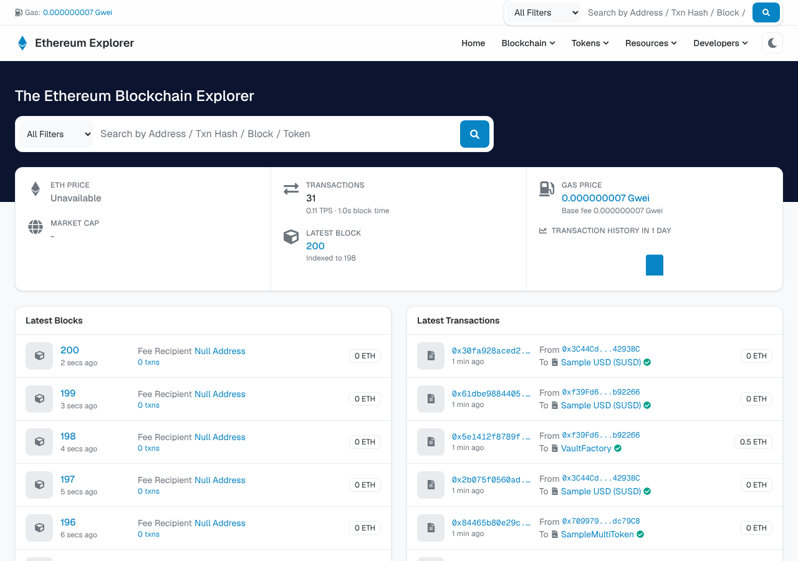
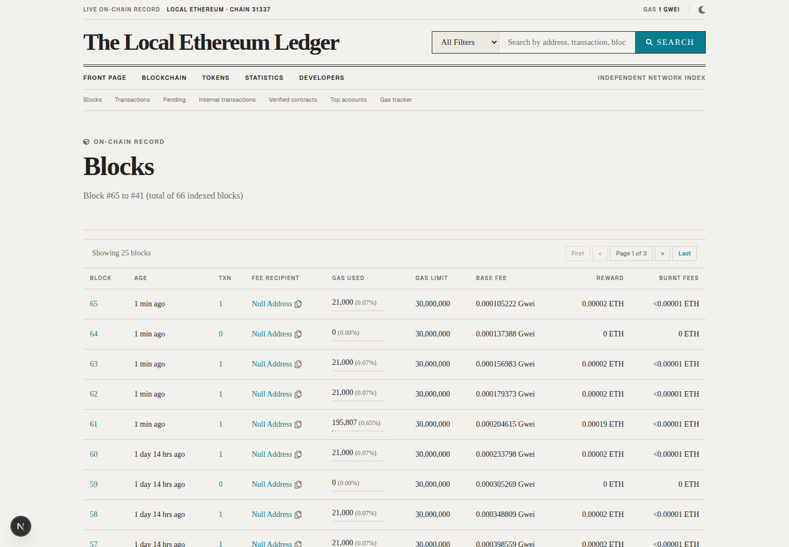
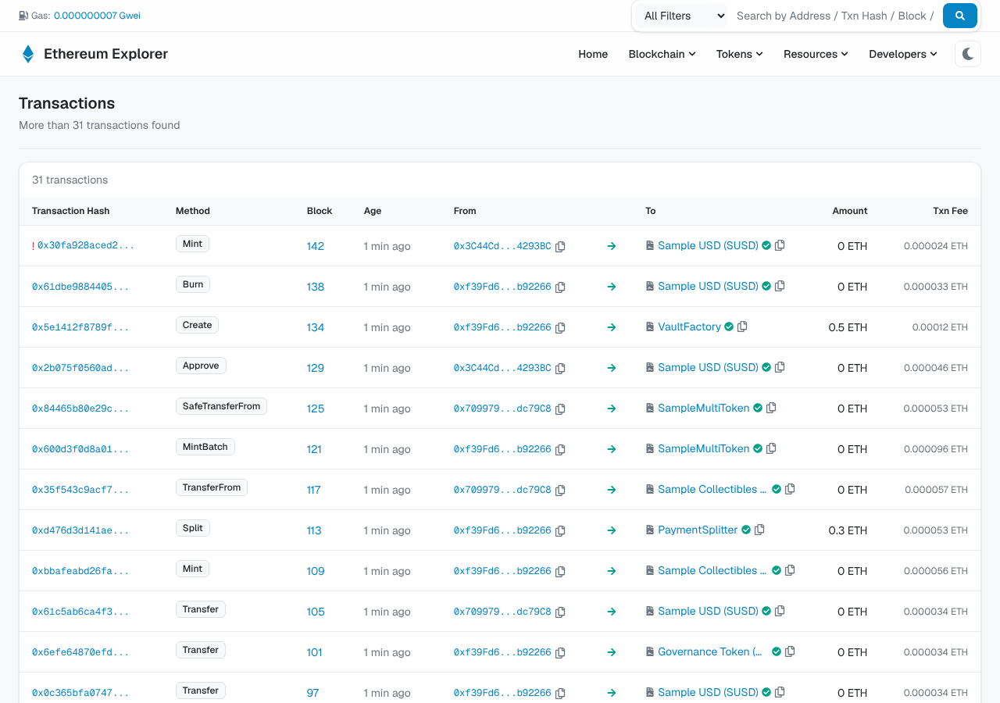
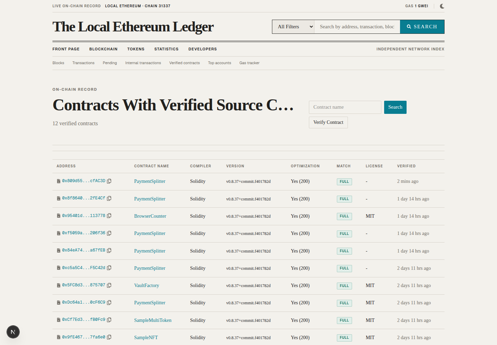

# EVM Block Explorer

A self-hosted Ethereum and EVM block explorer built with Next.js, MongoDB, and viem.

[Live demo](https://nextjs-ethereum-explorer.vercel.app/) · [Architecture](ARCHITECTURE.md) · [Contributing](CONTRIBUTING.md)

> **Proprietary software:** Copyright © 2024–2026 Aakash Singh Rajput. All rights reserved. This repository does not grant permission to use, copy, modify, deploy, or redistribute the code. See [LICENSE](LICENSE).

## Before you start

Choose **one** setup method. Do not mix their database settings.

| Setup | Use it when | Required software | App URL |
| --- | --- | --- | --- |
| [Local devnet](#option-1-local-devnet-recommended-for-testing) | You want the fastest complete demo | Node.js, MongoDB, Foundry/Anvil | `http://localhost:3017` |
| [Normal local development](#option-2-normal-local-development) | You want to index an existing EVM chain | Node.js, MongoDB, an RPC endpoint | `http://localhost:3000` |
| [Docker Compose](#option-3-docker-compose) | You want the full stack in containers | Docker Engine, Docker Compose, an RPC endpoint | `http://localhost:3000` |

Node.js **20.9 or newer** is required. Check your installed tools with:

```bash
node --version
npm --version
mongod --version
anvil --version
docker --version
```

You only need the commands relevant to the setup method you choose.

## Option 1: Local devnet (recommended for testing)

This starts a private local chain and a complete explorer with sample blocks, transactions, tokens, NFTs, and verified contracts.

### Requirements

- Node.js 20.9+
- npm
- MongoDB server (`mongod`)
- [Foundry](https://book.getfoundry.sh/getting-started/installation) with Anvil

### Steps

1. Clone the project and install dependencies:

   ```bash
   git clone https://github.com/aakash4dev/nextjs-ethereum-explorer.git
   cd nextjs-ethereum-explorer
   npm ci
   ```

2. Start the complete devnet stack:

   ```bash
   npm run devnet
   ```

   Keep this terminal open. The command starts and configures:

   - Anvil RPC on `127.0.0.1:8545`
   - MongoDB on `127.0.0.1:27018`
   - Database indexes and sample data
   - The blockchain indexer
   - The contract-verification worker
   - The web app on `http://localhost:3017`

3. Open [http://localhost:3017](http://localhost:3017).

4. Optional: run all local acceptance checks from another terminal:

   ```bash
   npm run devnet:test
   ```

Press `Ctrl+C` in the first terminal to stop services started by the devnet command. Its data and logs remain in `.devnet/` for the next run.

The devnet uses [`.env.devnet.example`](.env.devnet.example) directly. It does **not** use `.env` or `.env.local`, and you do not need to run `npm run db:indexes` separately.

> Never send real funds to Anvil accounts or use Anvil's public test keys on a public network.

## Option 2: Normal local development

Use this method to connect the explorer to Ethereum or another existing EVM-compatible chain.

### Requirements

- Node.js 20.9+
- npm
- A running MongoDB 6+ server
- A working EVM JSON-RPC endpoint
- A tracing-capable RPC if you want internal transactions

### Steps

1. Clone the project and install dependencies:

   ```bash
   git clone https://github.com/aakash4dev/nextjs-ethereum-explorer.git
   cd nextjs-ethereum-explorer
   npm ci
   ```

2. Create `.env` only if it does not already exist:

   ```bash
   cp .env.example .env
   ```

3. Edit `.env` and set at least:

   ```dotenv
   ETHEREUM_RPC_URL=https://your-rpc-endpoint
   MONGODB_URI=mongodb://127.0.0.1:27017/ethereum_indexer
   START_BLOCK=0
   ```

   For a large existing chain, set `START_BLOCK` to a recent block first. Starting from block `0` can require substantial time and storage.

4. Check for `.env.local` before continuing:

   ```bash
   ls -la .env.local
   ```

   `.env.local` has higher priority than `.env`. If it exists, update it to match your intended RPC and MongoDB settings, or rename it if you do not need it. A stale devnet value such as port `27018` will override the port `27017` in `.env`.

5. Start MongoDB **before** running database commands. On a Linux system using systemd:

   ```bash
   sudo systemctl start mongod
   sudo systemctl status mongod
   ```

   Alternatively, start a standalone MongoDB container:

   ```bash
   docker run --name ethereum-explorer-mongo -p 27017:27017 -d mongo:8.0
   ```

   Use only one MongoDB instance, and make sure its port matches `MONGODB_URI`.

6. Confirm that the RPC endpoint is reachable:

   ```bash
   npm run check-rpc
   ```

7. Create or reconcile MongoDB indexes:

   ```bash
   npm run db:indexes
   ```

8. Start the three required application processes in separate terminals:

   **Terminal 1 — web app**

   ```bash
   npm run dev
   ```

   **Terminal 2 — blockchain indexer**

   ```bash
   npm run sync
   ```

   **Terminal 3 — contract-verification worker**

   ```bash
   npm run verify:worker
   ```

9. Open [http://localhost:3000](http://localhost:3000).

The web app can start without the workers, but blocks will not continue syncing and queued contract verifications will not be processed.

## Option 3: Docker Compose

Docker Compose starts MongoDB, creates its indexes, and runs the web app, indexer, and verification worker.

### Requirements

- Docker Engine
- Docker Compose v2 (`docker compose`)
- A working EVM JSON-RPC endpoint

### Steps

1. Clone the project and enter its directory:

   ```bash
   git clone https://github.com/aakash4dev/nextjs-ethereum-explorer.git
   cd nextjs-ethereum-explorer
   ```

2. Create `.env` only if it does not already exist:

   ```bash
   cp .env.example .env
   ```

3. Set `ETHEREUM_RPC_URL`, `START_BLOCK`, and the chain branding values in `.env`. Compose supplies its own internal MongoDB URL, so you do not need a MongoDB server on the host.

4. Build and start the stack:

   ```bash
   docker compose up -d --build
   ```

5. Check container status and follow logs:

   ```bash
   docker compose ps
   docker compose logs -f
   ```

6. Open [http://localhost:3000](http://localhost:3000).

Stop the containers with:

```bash
docker compose down
```

MongoDB and compiler-cache data are stored in Docker volumes and remain available after `docker compose down`.

## Common startup problems

### `ECONNREFUSED 127.0.0.1:27018`

Your commands are loading a devnet MongoDB address from `.env.local`, but the devnet database is not running. Either run `npm run devnet`, or update/rename `.env.local` and use your normal MongoDB address.

### `ECONNREFUSED 127.0.0.1:27017`

MongoDB is not running on the configured port. Start MongoDB, then rerun `npm run db:indexes`.

### The site opens but no blocks appear

Make sure `npm run sync` is running and inspect its terminal for RPC or database errors. Also confirm `START_BLOCK` is not higher than the chain head.

### Contract verification stays queued

Make sure `npm run verify:worker` is running.

### Port `3000` or `3017` is already in use

Stop the process using that port. For the devnet, you can select another web port:

```bash
DEVNET_WEB_PORT=3018 npm run devnet
```

## Validate the project

```bash
npm run lint
npm test
npm run build
```

The complete local integration suite requires the devnet to be running:

```bash
npm run devnet:test
```

## Production processes

A production installation normally keeps the web app, indexer, and verification worker running as independent services.

Build and start the web app:

```bash
npm run build
npm start
```

Run these in separate services or process-manager entries:

```bash
npm run sync
npm run verify:worker
```

Run `npm run db:indexes` during deployment and monitor `/api/health`.

## Screenshots

### Home



<table>
  <tr>
    <td width="50%"><strong>Blocks</strong></td>
    <td width="50%"><strong>Transactions</strong></td>
  </tr>
  <tr>
    <td></td>
    <td></td>
  </tr>
</table>

### Deployed and verified contracts



## Author

**Aakash Singh Rajput** — Blockchain Developer

[Website](https://www.aakash4dev.com) · [GitHub](https://github.com/aakash4dev) · [LinkedIn](https://linkedin.com/in/aakash4dev) · [X/Twitter](https://twitter.com/aakash4dev) · [Email](mailto:aakash4dev.me@gmail.com)

Custom EVM explorer and indexer development is available as a paid engagement.

## License

Copyright © 2024–2026 Aakash Singh Rajput. All rights reserved. This project is proprietary and is **not open source**. No permission is granted to use, copy, modify, deploy, or redistribute it without prior written authorization. See [LICENSE](LICENSE) for the full terms.
